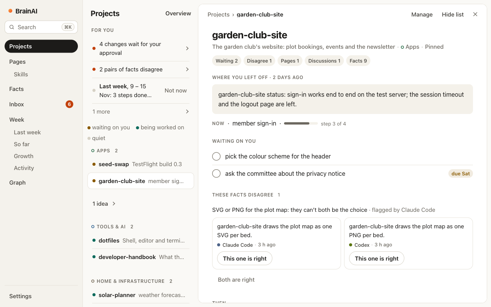
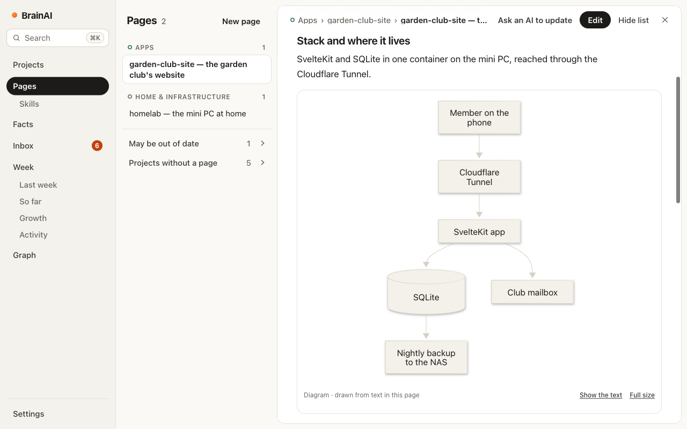
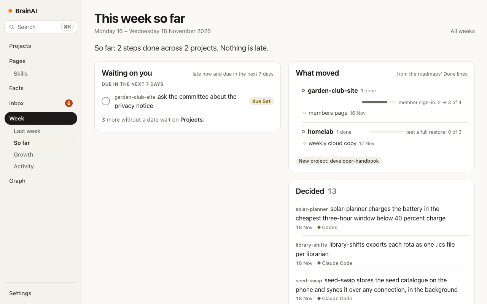
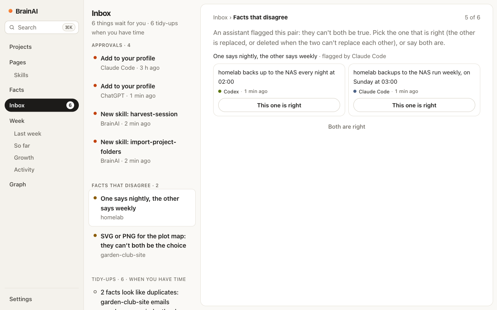
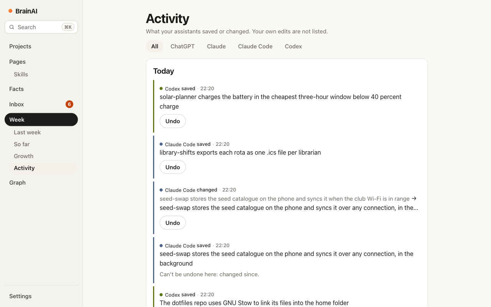
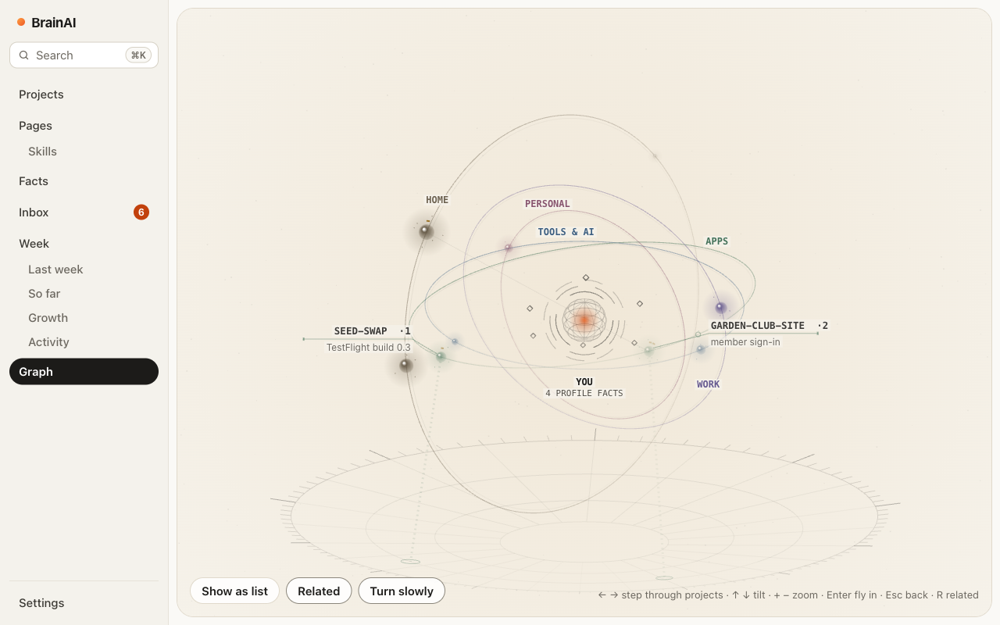
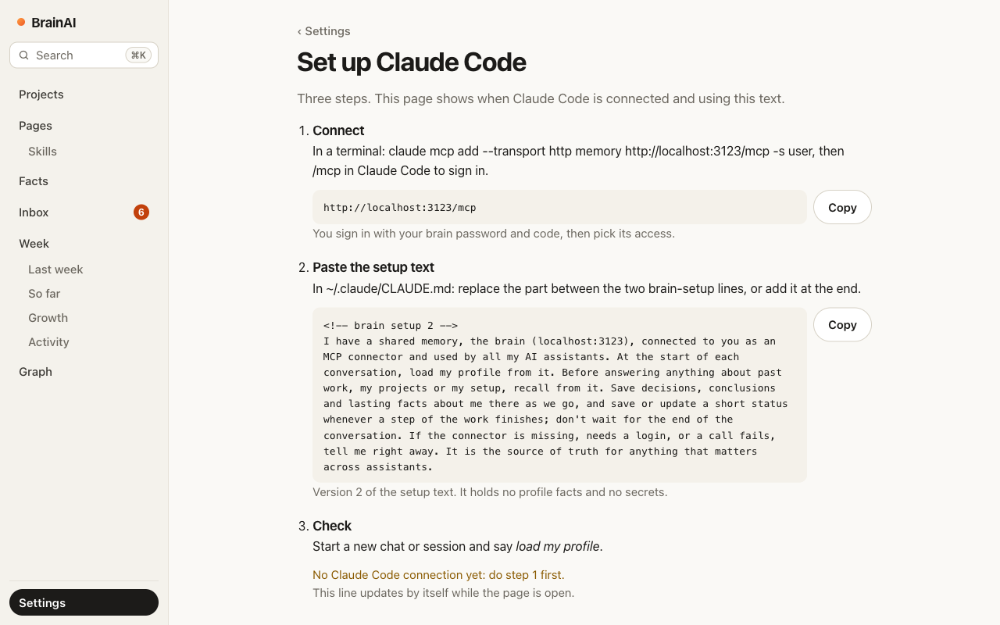
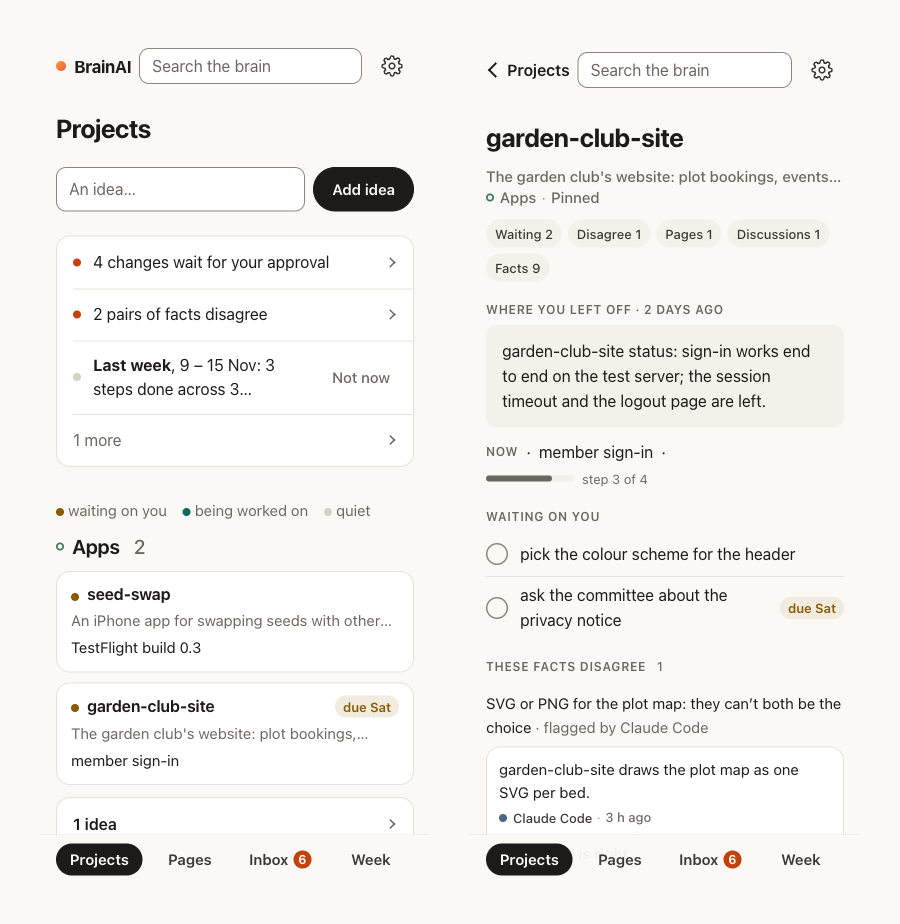

Read in English: [README.md](README.md)

# BrainAI

Una memoria compartida para todos tus asistentes de IA, en tu propio servidor.

Cuéntale una decisión a Claude y ChatGPT la conocerá mañana. Pregunta a Codex qué falta en un proyecto y leerá la
hoja de ruta que Claude Code actualizó anoche. BrainAI es un servidor pequeño al que se conecta, por MCP, cada
asistente que usas. Guarda **datos** cortos (decisiones, estados, hojas de ruta, tu perfil) y **páginas** largas (qué
es un proyecto, cómo funciona, por qué se construyó así), y tiene un panel donde ves y corriges todo.

Está pensado para una sola persona. No hay cuentas que compartir ni servicio en la nube: tus recuerdos viven en un
único archivo SQLite, en una máquina que es tuya.

> **Una versión temprana.** BrainAI gestiona a diario la memoria de una persona y se ensayó desde una instalación
> limpia, pero es joven.



## ¿Dónde va a vivir?

BrainAI es un programa pequeño con un único archivo de base de datos. Elige dónde se ejecuta; puedes empezar en tu
ordenador y pasar más adelante a un servidor sin perder ningún recuerdo.

| | Te conviene si | Necesitas | Guía |
|---|---|---|---|
| **Tu ordenador** | Quieres probarlo, o usarlo desde las apps de un solo ordenador | Un Mac con Apple silicon, o Windows 10/11 (x64) | `docs/es/DESKTOP.md` |
| **Un servidor en casa** | Quieres todos los asistentes, en la web y en el móvil, siempre disponibles | Una máquina Linux que se quede encendida, Docker, un dominio en Cloudflare | [Inicio rápido](#en-un-servidor-inicio-rápido) más abajo, `docs/es/RUNBOOK.md` |
| **Un servidor en la nube** | Lo mismo, sin una máquina en casa | Un pequeño servidor Linux alquilado, Docker, un dominio en Cloudflare | `docs/es/CLOUD.md` |

- **Tu ordenador:** la app ejecuta BrainAI sin servidor, sin dominio y sin contraseña, y conecta Claude Code,
  Codex, OpenCode, Cursor, Gemini CLI (aún sin probar) y la app de escritorio de Claude con un clic cada uno (con
  recordatorios para guardar donde la herramienta lo permite). *Acceso desde el móvil y la web* añade una dirección
  pública (con Tailscale, o con tu propio dominio en Cloudflare) mientras el Mac está encendido. La app para Mac
  ocupa unos 281 MiB: no incluye los modelos de búsqueda. En el primer arranque te sugiere modelos para tu ordenador
  y descarga los que elijas (cámbialos después en Ajustes › Búsqueda). Te avisa cuando hay una versión nueva y se
  actualiza cuando tú se lo dices.

  **Consigue la app** en la [última versión](https://github.com/jsr1292/brainai/releases/latest):
  - **Mac (Apple silicon):** abre el `.dmg` y arrastra BrainAI a Aplicaciones.
  - **Windows 10/11:** ejecuta el `…-setup.exe`. Windows pregunta una vez por un editor desconocido: **Más
    información › Ejecutar de todas formas**. O, en PowerShell, una línea que antes comprueba la descarga:
    `irm https://github.com/jsr1292/brainai/releases/latest/download/install-app.ps1 | iex`
- **Un servidor** mantiene BrainAI accesible todo el tiempo. *Pasar a un servidor*, en la app, lleva allí todos tus
  recuerdos (`docs/es/RUNBOOK.md`, "Pasar desde la app").

## Qué obtienes

- **Todos los asistentes, una sola memoria.** Claude, ChatGPT y Grok (web y móvil), y Claude Code, Codex, Grok Build
  y OpenCode en tu ordenador. Cada uno se conecta con OAuth y tú decides qué puede hacer.
- **Un plugin de una sola instalación para Claude Code:** `claude plugin marketplace add jsr1292/brainai`, y después
  `claude plugin install brainai@brainai-plugins` (`docs/es/CLIENTS.md`, "Instalar como plugin").
- **Recuperación por significado,** en varios idiomas, con un resumen por proyecto: sus estados, decisiones, hoja de
  ruta y páginas en una sola llamada. Un pequeño modelo local reordena las primeras coincidencias de cada búsqueda
  para que la mejor respuesta salga primero. Los proyectos pueden tener apodos, y un asistente puede enviar una
  versión en inglés de una pregunta hecha en otro idioma. Lo bien que encuentra las cosas se mide en dos pruebas
  públicas, LoCoMo y LongMemEval, solo de recuperación (`docs/es/BENCHMARK.md`); que el ciclo completo (guardar,
  sustituir, olvidar, responder) funcione con asistentes reales se mide en una pequeña evaluación de extremo a
  extremo, con sus fallos y sus carencias abiertas publicados (`docs/es/LIFECYCLE-EVAL.md`). `docs/es/REPRODUCE.md`
  tiene los comandos para comprobar tú mismo cada afirmación.
- **Datos que dicen cuánto duran y de dónde vienen.** Un asistente puede marcar un dato como válido hasta una fecha
  (un plazo, una versión, quién tiene un trabajo): así todos los asistentes ven cuándo ha pasado su fecha. Cada dato
  puede indicar si lo dijiste tú o lo dedujo un asistente, y quién lo anotó. Un asistente que dice que tú dijiste
  algo tiene que citar tus palabras, y la etiqueta cubre solo esa cita; sin ella, el dato se guarda como deducción
  propia. A veces los asistentes siguen escribiendo su sugerencia dentro del mismo dato (`docs/es/LIFECYCLE-EVAL.md`,
  S3).
- **Tú apruebas lo que importa.** Los cambios en tu perfil, y los recuerdos que parecen instrucciones para un
  asistente, esperan tu respuesta en una única Bandeja, agrupados y con Deshacer. Lo que borras se queda borrado: un
  asistente que lo vuelve a guardar, con las mismas palabras o con otras parecidas, queda retenido a la espera de tu
  aprobación. Una reformulación profunda aún puede colarse (límites medidos en `docs/es/SECURITY.md`). Las contraseñas
  y las claves se rechazan.
- **Ves y controlas lo que hacen los asistentes.** Actividad enumera lo que cada asistente guardó, cambió o borró, con
  Deshacer en cada dato. "El guardado espera mi aprobación" retiene los guardados de un asistente hasta que los
  apruebes; "Pausar el guardado de todos los asistentes" los detiene todos.
- **Nada se pierde al acabar una sesión.** Recordatorios de guardado para Claude Code, Codex y Cursor, y una habilidad
  de cosecha: un asistente envía en un solo lote lo que decidió una sesión, y el lote espera en tu Bandeja hasta que
  lo apruebes.
- **Una memoria que se mantiene ordenada.** Pide a un asistente que ordene un proyecto: propone fusionar, sustituir o
  pasar decisiones antiguas a la página del proyecto, y tú apruebas cada una. Las sugerencias de orden señalan lo que
  está obsoleto, duplicado o pasado de fecha. Cuando dos datos no pueden ser ciertos a la vez, eliges el que es
  correcto.
- **Trae lo que ya tienes.** Pega lo que ChatGPT, Claude o Gemini recuerdan de ti y marca lo que quieres conservar,
  deja que un asistente de programación proponga datos a partir de las carpetas de tus proyectos, o añade un archivo
  Markdown como página.
- **El panel:** proyectos y sus páginas, una revisión semanal de lo que se movió, el estado de la memoria,
  imágenes y diagramas en las páginas, en un ordenador o en un móvil.
- **Debates:** haz la misma pregunta a varios asistentes y deja que se respondan entre sí por rondas.
- **Habilidades compartidas:** comparte una habilidad desde un ordenador y tus otros asistentes podrán cargarla.
- **Copias de seguridad que salen de casa:** instantáneas nocturnas a tus otros discos, una exportación nocturna en
  Markdown a git y una copia semanal cifrada en la nube. En la app, Hacer copia ahora y una segunda carpeta a tu
  elección. Un simulacro de restauración con script restaura cada tipo de copia en una máquina limpia y comprueba los
  datos, las páginas, las imágenes, el historial y la búsqueda: `npm run drill:restore`, con los resultados en
  `docs/es/RESTORE-DRILL.md`.
- **Puedes irte cuando quieras, con todo:** una carpeta guardada con todos tus recuerdos, legible y lista para volver
  a traerla.

## Un vistazo

Las capturas muestran una memoria de ejemplo con proyectos inventados (`npm run demo:seed`, más abajo).

| | |
|---|---|
|  |  |
| **Las páginas** guardan qué es un proyecto y cómo funciona, con diagramas dibujados a partir de texto. | **La semana** muestra qué se movió en cada hoja de ruta, qué se decidió y qué asistente lo hizo. |
|  |  |
| **La Bandeja** reúne lo que espera tu respuesta, agrupado: aprobaciones, sesiones cosechadas, propuestas de orden, desacuerdos. | **Actividad** muestra lo que cada asistente guardó o cambió, día a día, con Deshacer. |
|  |  |
| **El grafo** coloca cada proyecto en su área, con los hilos que los unen. | **Conectar una app** lleva unos pocos pasos, y la página muestra si ha funcionado. |



## En un servidor: inicio rápido

Necesitas un servidor Linux (x86_64 o arm64, con unos 1,5 GB de memoria para la app) con Docker, y un dominio en
Cloudflare. `docs/es/RUNBOOK.md` explica cada paso al detalle, incluidas las copias de seguridad y la monitorización.

1. **Deja que tu usuario ejecute Docker** (los scripts de copia nocturna lo llaman sin sudo), y después cierra la
   sesión y vuelve a entrar:
   ```bash
   sudo usermod -aG docker $USER
   ```
2. **Crea un túnel de Cloudflare** en el panel de Cloudflare (Networking › Tunnels). Copia su token, la cadena larga
   que empieza por `eyJ`, y añade una ruta (aplicación publicada) de `memory.<tu dominio>` a `http://app:3000`.
   El túnel es la única entrada: no se publica ningún puerto.
3. **Consigue BrainAI y rellena `.env`:**
   ```bash
   git clone https://github.com/jsr1292/brainai.git ~/memory && cd ~/memory
   mkdir -p data backups overlay
   cp .env.example .env        # set PUBLIC_URL, TUNNEL_TOKEN, and PUID / PGID (the output of `id -u` / `id -g`)
   ```
4. **Arráncalo.** La primera compilación descarga los modelos de búsqueda, así que tarda unos minutos:
   ```bash
   docker compose up -d --build
   ```
5. **Crea tu acceso:** una contraseña y después una app de autenticación (muestra un código QR):
   ```bash
   docker compose exec app node dist/cli.js set-password
   docker compose exec app node dist/cli.js setup-totp
   ```
6. **Abre `https://memory.<tu dominio>`** e inicia sesión. La primera pantalla te lleva a conectar tu primer
   asistente.

## Conectar tus apps

Abre **Ajustes › Configurar una app** y elige una: cada app tiene su propia página con la dirección que debes añadir,
el texto que debes pegar en sus instrucciones y una línea que indica cuándo funciona. Claude y las apps de tu
ordenador pueden conectarse directamente. ChatGPT, Grok y Codex necesitan antes un clic, **Permitir que … inicie
sesión**, en su página; si una app sigue rechazada, la dirección que intentó usar aparece ahí con un botón Permitir.
`docs/es/CLIENTS.md` tiene los detalles de cada app.

## Actualizar

```bash
cd ~/memory && git pull && docker compose up -d --build
```

Antes de cualquier cambio en la base de datos, BrainAI la copia en `data/pre-migrate/`. Ajustes › Copias de seguridad
muestra la versión que usas, y `CHANGELOG.md` dice qué cambió y si necesitas hacer algo. Si cambió el texto de
configuración de una app, Ajustes te dice qué apps hay que actualizar.

## Dejar BrainAI

Ajustes › **Guardar una copia de todo** guarda tus recuerdos cuando quieras. En la app crea una carpeta en
Documentos. En un servidor, el panel te pide el código de tu app de autenticación y lo descarga como `.tar.gz`. La
carpeta contiene un archivo que BrainAI puede volver a leer, cada página y cada dato en Markdown, y un README. No está
cifrada: mantenla en privado.

- **La app:** Ajustes › **Quitar BrainAI**. Primero guarda una copia y se detiene si eso falla. Después desactiva el
  acceso remoto, desconecta tus herramientas de programación, borra sus propios datos y se elimina. La carpeta
  guardada se queda.
- **Un servidor:** `scripts/remove.sh` en la carpeta de BrainAI. Guarda una copia en tu carpeta personal, enumera lo
  que va a eliminar y espera hasta que escribas `remove`. Las copias fuera del servidor (Google Drive, otros discos)
  se conservan salvo que digas que sí a cada una.
- **Volver:** en una instalación nueva, la bienvenida de la app ofrece **Tengo una carpeta de BrainAI guardada**. En un
  servidor, ejecuta `docker compose run --rm app node dist/cli.js restore data/<file>` (`docs/es/RUNBOOK.md`).

Hay cosas que BrainAI no puede quitar por ti, como los conectores de Claude, ChatGPT y Grok en la web. La eliminación
termina con una lista de comprobación de esos conectores, y el README de la carpeta guardada la conserva.

## Tus propios ajustes: el overlay

Todo lo personal vive en `overlay/`, que nunca se sube a git ni lo toca una actualización. Parte de
`overlay.example/`:

- `setup.json` añade tus propias líneas al texto de configuración que recibe cada app. `extra` admite una app
  (`claude`, `chatgpt`, `grok`, `grok-build`, `claude-code`, `codex`, `opencode`) o `coding` (todas las herramientas de
  programación) y una lista de líneas. Sube `version` cuando lo cambies, y Ajustes muestra qué apps siguen con el
  texto antiguo.
- `scripts.env` contiene los ajustes de los scripts nocturnos: adónde se copian las copias de seguridad y el nombre
  que aparece en los commits de la exportación.

## Documentación

- `docs/es/RUNBOOK.md`: instalar, ejecutar, hacer copias, restaurar y actualizar.
- `docs/es/CLIENTS.md`: conectar cada app.
- `docs/es/DESKTOP.md`: la app de escritorio (Mac, y Windows en pruebas): conectar tus herramientas, acceso desde el
  móvil y la web, pasar a un servidor.
- `docs/es/CLOUD.md`: ejecutar BrainAI en un servidor alquilado.
- `docs/es/IMPORT.md`: traer lo que ya tienes.
- `docs/es/ARCHITECTURE.md`: cómo está construido.
- `docs/es/BENCHMARK.md`: lo bien que la recuperación encuentra las cosas, medido en LoCoMo y LongMemEval.
- `docs/es/LIFECYCLE-EVAL.md`: el ciclo completo de la memoria con asistentes reales, fallos incluidos.
- `docs/es/REPRODUCE.md`: cada afirmación anterior con el comando que la comprueba, para ejecutarlo en tu propio
  ordenador.
- `SECURITY.es.md`: cómo se mantiene seguro y cómo informar de un problema.

## Desarrollo

Node 22 o superior.

```bash
npm ci
npm run typecheck
npm test
npm run model        # once: downloads the search models into ./models (about 275 MB)
PUBLIC_URL=http://localhost:3000 npm run dev
```

Para curiosear con datos de ejemplo en lugar de los tuyos, genera una carpeta nueva y arranca el servidor sobre ella:

```bash
npm run demo:seed -- ./demo-data
DATA_DIR=./demo-data PUBLIC_URL=http://localhost:3000 npm run dev
```

Inicia sesión con la contraseña `try-brainai-demo` y el código de `npm run demo:code`. Ese acceso es público: usa la
carpeta de demostración solo para los datos de ejemplo, nunca para tus propios recuerdos. La semana de ejemplo se
fecha a partir del día en que la generas, así que borra la carpeta y genérala de nuevo para tener una reciente.

### Publicar versiones

Las versiones se publican desde una copia de trabajo privada:

```bash
PUBLISH_NAME=… PUBLISH_EMAIL=… scripts/publish/release.sh <denylist> <public-repo-url> <version> [--dry-run]
```

Comprueba el HEAD confirmado con la puerta de publicación (`scripts/publish/check-public-tree.sh`, pruebas incluidas)
y solo entonces lo sube al repositorio público como un único commit y etiqueta, con autoría
`PUBLISH_NAME <PUBLISH_EMAIL>`. Escribe y confirma antes la entrada de `CHANGELOG.md` de esa versión.

## Seguridad

Los límites de confianza, los controles y la revisión adversaria del propio autor (no es una auditoría independiente)
están en [`docs/es/SECURITY.md`](docs/es/SECURITY.md); cómo informar de un problema está en `SECURITY.es.md`.

## Licencia

MIT. Consulta `LICENSE`.

Los modelos de búsqueda no forman parte de esa licencia. EmbeddingGemma (el modelo de búsqueda por defecto) se ofrece
bajo los Términos de uso de Gemma, que están en ai.google.dev/gemma/terms, y está sujeto a ellos: consulta
`licenses/GEMMA-NOTICE.txt`. Los otros modelos son multilingual-e5-small (MIT) y mmarco-mMiniLMv2 (Apache-2.0).
