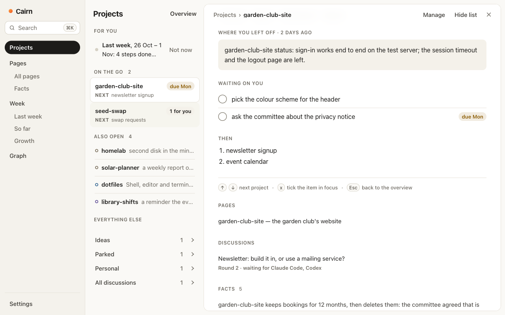
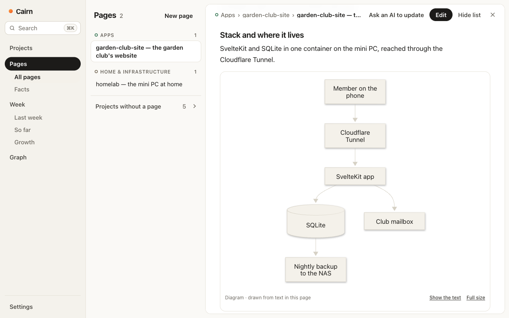
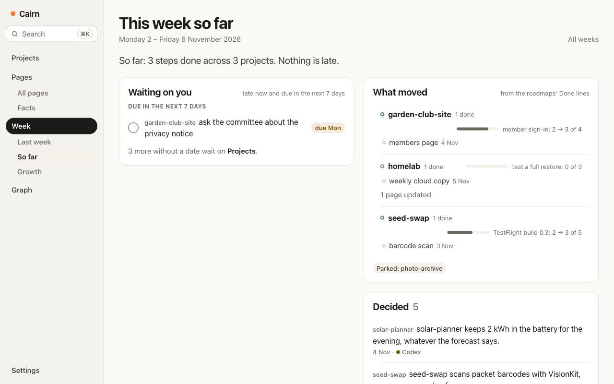
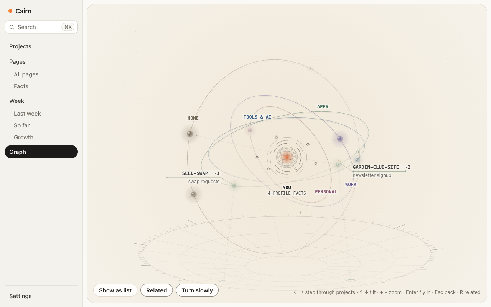
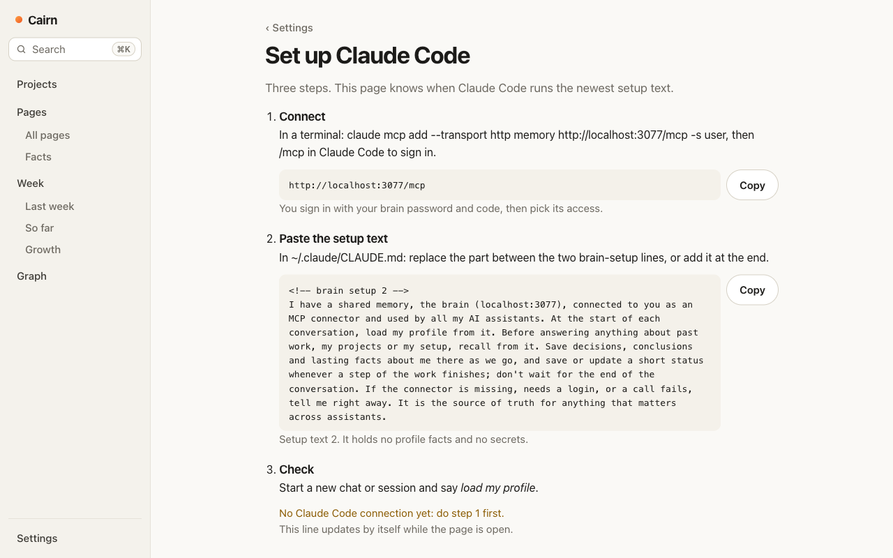
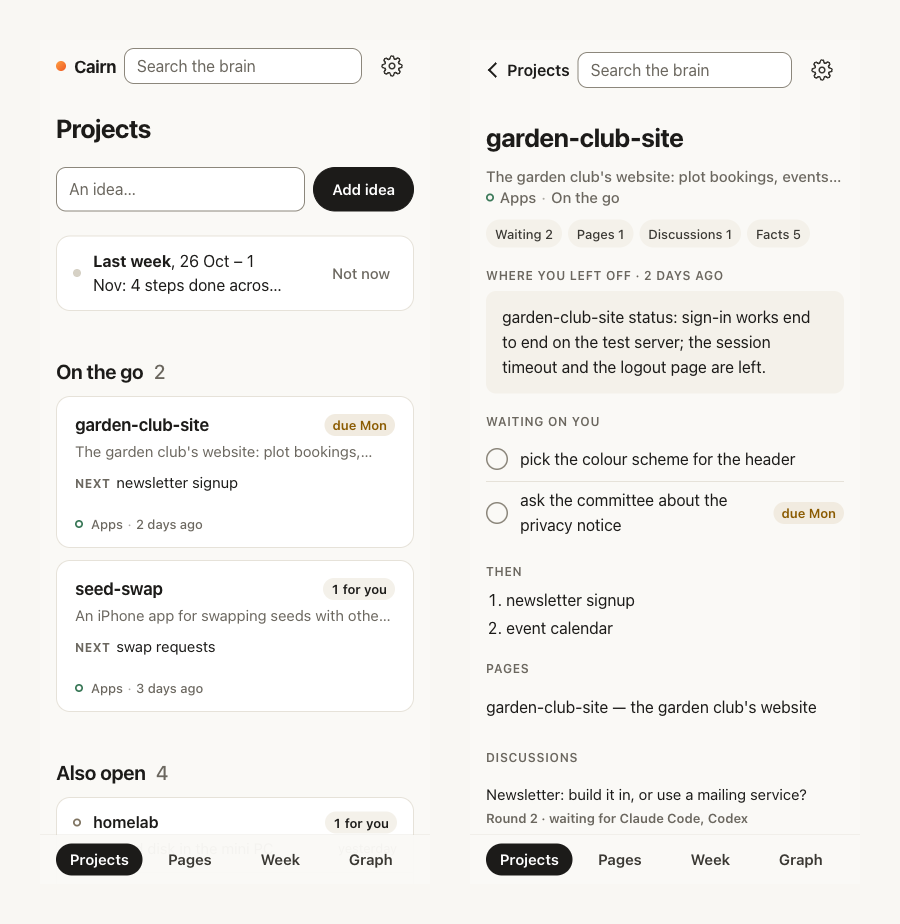

# Cairn

A shared brain for all your AI assistants, on your own server.

Tell Claude about a decision, and ChatGPT knows it tomorrow. Ask Codex what's left on a project, and it reads the
roadmap Claude Code updated last night. Cairn is one small server that every assistant you use connects to over
MCP. It keeps short **facts** (decisions, statuses, roadmaps, your profile) and long **pages** (what a project is,
how it runs, why it was built that way), and a dashboard where you see and correct all of it.

It is built for one person. There are no accounts to share and no cloud service: your memories live in one SQLite
file on a machine you own.

> **An early release.** Cairn runs one person's brain every day, and it was rehearsed from a clean install, but it is
> young. Today it suits someone comfortable running a small server with Docker. A desktop app that installs with a
> double-click is planned.



## What you get

- **Every assistant, one memory.** Claude, ChatGPT and Grok (web and phone), and Claude Code, Codex, Grok Build and
  OpenCode on your computer. Each connects with OAuth, and you choose what it may do.
- **Recall by meaning,** in several languages, with a briefing per project: its statuses, decisions and roadmap in
  one call.
- **You approve what matters.** Changes to your profile, and memories that read like instructions to an assistant,
  wait for you. What you delete stays deleted. Passwords and keys are refused.
- **The dashboard:** projects and their pages, a weekly review of what moved, tidy-up suggestions for memories that
  are stale or duplicated, pictures and diagrams in pages.
- **Discussions:** ask several assistants the same question and let them answer each other in rounds.
- **Shared skills:** share a skill from one computer and your other assistants can load it.
- **Backups that leave the house:** nightly snapshots to your other drives, a nightly Markdown export into git, and a
  weekly encrypted copy in the cloud.
- **A work copy:** a separate brain for a work laptop, sharing nothing with home (`docs/WORK.md`).

## A look around

The screenshots show a sample brain with made-up projects (`npm run demo:seed`, below).

| | |
|---|---|
|  |  |
| **Pages** keep what a project is and how it runs, with diagrams drawn from text. | **The week** shows what moved on each roadmap, what was decided and by which assistant. |
|  |  |
| **The graph** places every project by area, with the threads between them. | **Connecting an app** takes three steps, and the page shows whether it worked. |



## Quick start

You need a Linux server (x86_64 or arm64, about 1 GB of memory for the app) with Docker, and a domain on Cloudflare.
`docs/RUNBOOK.md` walks through every step in detail, including backups and monitoring.

1. **Let your user run Docker** (the nightly backup scripts call it without sudo), then log out and back in:
   ```bash
   sudo usermod -aG docker $USER
   ```
2. **Create a Cloudflare Tunnel** in the Cloudflare dashboard (Networking › Tunnels). Copy its token, the long string
   starting with `eyJ`, and add a route (published application) from `memory.<your domain>` to `http://app:3000`.
   The tunnel is the only way in: no port is published.
3. **Get Cairn and fill in `.env`:**
   ```bash
   git clone https://github.com/jsr1292/cairn.git ~/memory && cd ~/memory
   mkdir -p data backups overlay
   cp .env.example .env        # set PUBLIC_URL, TUNNEL_TOKEN, and PUID / PGID (the output of `id -u` / `id -g`)
   ```
4. **Start it.** The first build downloads the search model, so it takes a few minutes:
   ```bash
   docker compose up -d --build
   ```
5. **Create your login:** a password, then an authenticator app (it shows a QR code):
   ```bash
   docker compose exec app node dist/cli.js set-password
   docker compose exec app node dist/cli.js setup-totp
   ```
6. **Open `https://memory.<your domain>`** and sign in. The first screen takes you to connecting your first assistant.

## Connecting your apps

Open **Settings › Set up an app** and pick one: each app has its own page with the address to add, the text to paste
into its instructions, and a line that shows when it works. Claude and the apps on your computer can connect straight
away. ChatGPT, Grok and Codex need one click first, **Allow … to sign in**, on their page; if an app is still refused,
the address it tried shows there with an Allow button. `docs/CLIENTS.md` has the details for each app.

## Updating

```bash
cd ~/memory && git pull && docker compose up -d --build
```

Before any change to the database, Cairn copies it to `data/pre-migrate/`. Settings › Backups and health shows
the version you run, and `CHANGELOG.md` says what changed and whether anything is needed from you. If an app's setup
text changed, Settings tells you which apps to update.

## Your own settings: the overlay

Anything personal lives in `overlay/`, which is never committed and never touched by an update. Start from
`overlay.example/`:

- `setup.json` adds your own lines to the setup text each app gets. `extra` takes an app (`claude`, `chatgpt`,
  `grok`, `grok-build`, `claude-code`, `codex`, `opencode`) or `coding` (all the coding tools) and a list of lines.
  Raise `version` when you change it, and Settings shows which apps still have the old text.
- `scripts.env` holds the settings of the nightly scripts: where backups are copied, and the name on the export's
  commits.

## Documentation

- `docs/RUNBOOK.md`: install, run, back up, restore and update.
- `docs/CLIENTS.md`: connecting each app.
- `docs/WORK.md`: the separate work copy.
- `docs/IMPORT.md`: bringing in what you already have.
- `docs/ARCHITECTURE.md`: how it is built.
- `SECURITY.md`: how it is kept safe, and how to report a problem.

## Developing

Node 22 or newer.

```bash
npm ci
npm run typecheck
npm test
npm run model        # once: downloads the search model into ./models (about 130 MB)
PUBLIC_URL=http://localhost:3000 npm run dev
```

To look around with sample data instead of your own, seed a new folder and start the server on it:

```bash
npm run demo:seed -- ./demo-data
DATA_DIR=./demo-data PUBLIC_URL=http://localhost:3000 npm run dev
```

Sign in with the password `try-cairn-demo` and the code from `npm run demo:code`. That login is public: keep the demo
folder for the sample data only, never for your own memories. The sample week is dated from the day you seed it, so
delete the folder and seed again for a fresh one.

## Licence

MIT. See `LICENSE`.
