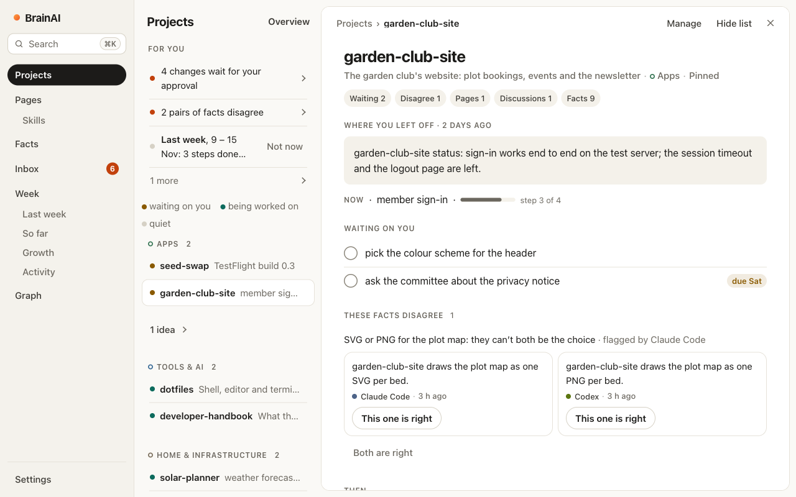
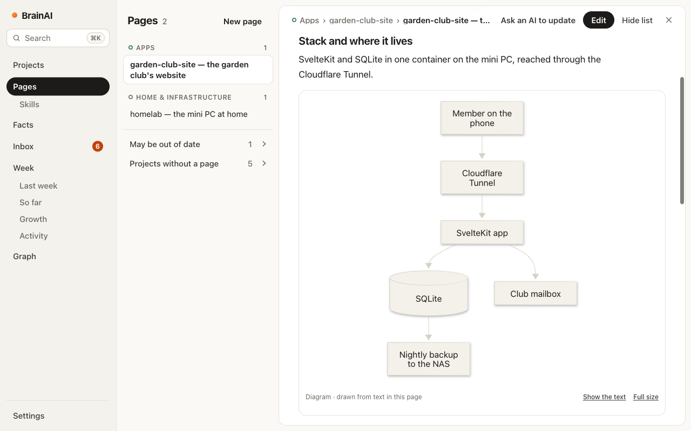
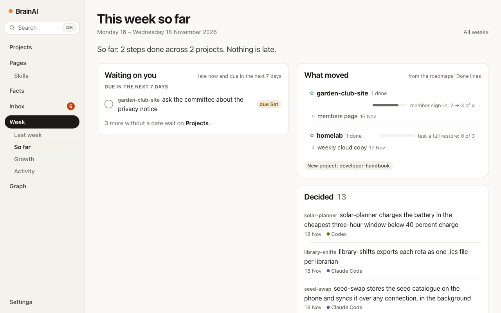
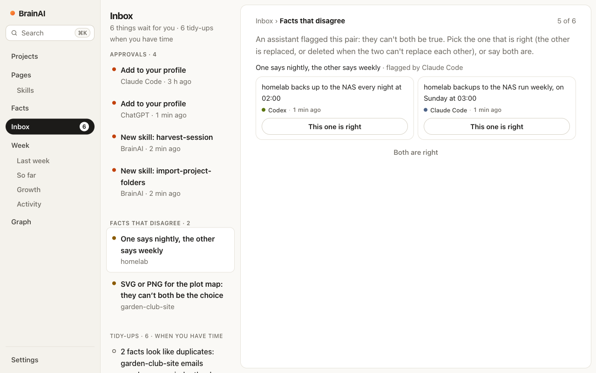
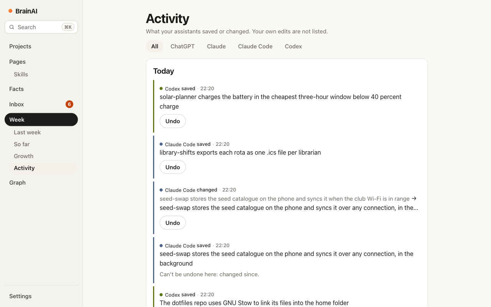
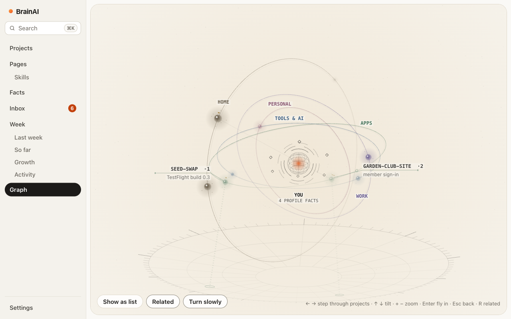
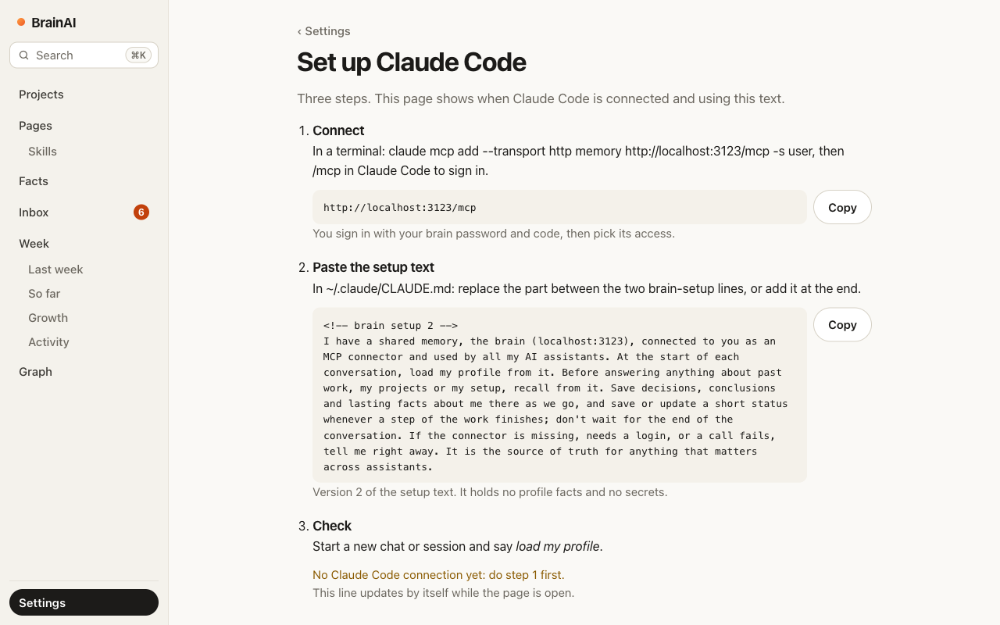
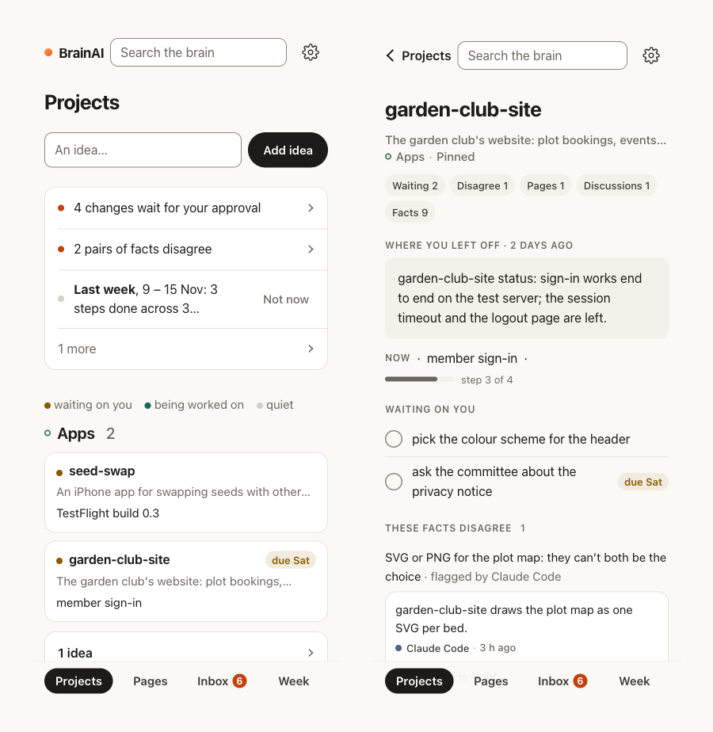

# BrainAI

A shared brain for all your AI assistants, on your own server.

Tell Claude about a decision, and ChatGPT knows it tomorrow. Ask Codex what's left on a project, and it reads the
roadmap Claude Code updated last night. BrainAI is one small server that every assistant you use connects to over
MCP. It keeps short **facts** (decisions, statuses, roadmaps, your profile) and long **pages** (what a project is,
how it runs, why it was built that way), and a dashboard where you see and correct all of it.

It is built for one person. There are no accounts to share and no cloud service: your memories live in one SQLite
file on a machine you own.

> **An early release.** BrainAI runs one person's brain every day, and it was rehearsed from a clean install, but it is
> young.



## Where will it live?

BrainAI is one small program with one database file. Pick where it runs; you can start on your computer and move to a
server later without losing a memory.

| | Suits | Needs | Guide |
|---|---|---|---|
| **Your computer** | Trying it, or using it from the apps on one computer | A Mac with Apple silicon, or Windows 10/11 (x64) | `docs/DESKTOP.md` |
| **A home server** | Every assistant, on the web and the phone, all the time | A Linux machine that stays on, Docker, a domain on Cloudflare | [Quick start](#on-a-server-quick-start) below, `docs/RUNBOOK.md` |
| **A cloud server** | The same, without a machine at home | A small rented Linux server, Docker, a domain on Cloudflare | `docs/CLOUD.md` |

- **Your computer:** the app runs BrainAI with no server, no domain and no password, and connects Claude Code,
  Codex, OpenCode, Cursor, Gemini CLI (not tested yet) and Claude's desktop app in one click each (with save reminders where the tool allows). *Reach from phone and web* adds a public address (through Tailscale,
  or your own domain on Cloudflare) while the Mac is on. The Mac app is about 281 MiB: it does not carry the search
  models. On first run it suggests models for your computer and downloads the ones you pick (change them later in
  Settings › Search). It tells you when a new version is out and updates itself when you say so.

  **Get the app** from the [latest release](https://github.com/jsr1292/brainai/releases/latest):
  - **Mac (Apple silicon):** open the `.dmg` and drag BrainAI to Applications.
  - **Windows 10/11:** run the `…-setup.exe`. Windows asks once about an unknown publisher: **More info › Run anyway**.
    Or, in PowerShell, one line that checks the download first:
    `irm https://github.com/jsr1292/brainai/releases/latest/download/install-app.ps1 | iex`
- **A server** keeps BrainAI reachable all the time. *Move to a server* in the app takes every memory there
  (`docs/RUNBOOK.md`, "Moving from the app").

## What you get

- **Every assistant, one memory.** Claude, ChatGPT and Grok (web and phone), and Claude Code, Codex, Grok Build and
  OpenCode on your computer. Each connects with OAuth, and you choose what it may do.
- **One-install plugin for Claude Code:** `claude plugin marketplace add jsr1292/brainai`, then
  `claude plugin install brainai@brainai-plugins` (`docs/CLIENTS.md`, "Install as a plugin").
- **Recall by meaning,** in several languages, with a briefing per project: its statuses, decisions, roadmap and pages
  in one call. A small local model reorders each search's first matches so the best answer comes first. Projects can
  have nicknames, and an assistant can send an English version of a question asked in another language. How well it
  finds things is measured on two public tests, LoCoMo and LongMemEval, retrieval only (`docs/BENCHMARK.md`); whether
  the whole loop (saving, replacing, forgetting, answering) works with real assistants is measured in a small end-to-end
  eval, with its failures and open gaps published (`docs/LIFECYCLE-EVAL.md`). `docs/REPRODUCE.md` has the commands to check each claim yourself.
- **Facts that say how long they hold and where they came from.** An assistant can mark a fact as valid until a date
  (a deadline, a version, who holds a job): every assistant then sees when it is past its date. Each fact can say
  whether you said it or an assistant inferred it, and who recorded that. An assistant that says you said something
  has to quote your words, and the label covers only that quote; without one the fact is stored as its own inference.
  Assistants still sometimes write their suggestion into the same fact (`docs/LIFECYCLE-EVAL.md`, S3).
- **You approve what matters.** Changes to your profile, and memories that read like instructions to an assistant,
  wait for you in one Inbox, grouped, with Undo. What you delete stays deleted: an assistant that saves it again, in the same or
  similar words, is held for your approval. A heavy rewording can still get through (measured limits in
  `docs/SECURITY.md`). Passwords and keys are refused.
- **You see and control what assistants do.** Activity lists what each assistant saved, changed or deleted, with Undo
  on each fact. "Saves wait for me" holds one assistant's saves for your approval; "Pause all saves" stops them all.
- **Nothing gets lost at the end of a session.** Save reminders for Claude Code, Codex and Cursor, and a harvest
  skill: an assistant sends what a session decided in one batch, which waits in your Inbox until you approve it.
- **Memory that stays tidy.** Ask an assistant to tidy a project: it proposes merging, replacing or moving old
  decisions into the project's page, and you approve each one. Tidy-up suggestions flag what is stale, duplicated or
  past its date. When two facts can't both be true, you pick the one that is right.
- **Bring what you already have.** Paste what ChatGPT, Claude or Gemini remember about you and tick what to keep, let a
  coding assistant propose facts from your project folders, or add a Markdown file as a page.
- **The dashboard:** projects and their pages, a weekly review of what moved, brain health, pictures and diagrams in
  pages, on a computer or a phone.
- **Discussions:** ask several assistants the same question and let them answer each other in rounds.
- **Shared skills:** share a skill from one computer and your other assistants can load it.
- **Backups that leave the house:** nightly snapshots to your other drives, a nightly Markdown export into git, and a
  weekly encrypted copy in the cloud. In the app, Back up now and a second folder of your choice. A scripted restore
  drill restores each kind of copy onto a clean machine and checks the facts, pages, pictures, history and search: `npm run drill:restore`, results in `docs/RESTORE-DRILL.md`.
- **You can leave any time, with everything:** one saved folder with every memory, readable and ready to bring back.

## A look around

The screenshots show a sample brain with made-up projects (`npm run demo:seed`, below).

| | |
|---|---|
|  |  |
| **Pages** keep what a project is and how it runs, with diagrams drawn from text. | **The week** shows what moved on each roadmap, what was decided and by which assistant. |
|  |  |
| **The Inbox** holds what waits for you, grouped: approvals, harvested sessions, tidy proposals, disagreements. | **Activity** shows what each assistant saved or changed, day by day, with Undo. |
|  |  |
| **The graph** places every project by area, with the threads between them. | **Connecting an app** takes a few steps, and the page shows whether it worked. |



## On a server: quick start

You need a Linux server (x86_64 or arm64, about 1.5 GB of memory for the app) with Docker, and a domain on Cloudflare.
`docs/RUNBOOK.md` walks through every step in detail, including backups and monitoring.

1. **Let your user run Docker** (the nightly backup scripts call it without sudo), then log out and back in:
   ```bash
   sudo usermod -aG docker $USER
   ```
2. **Create a Cloudflare Tunnel** in the Cloudflare dashboard (Networking › Tunnels). Copy its token, the long string
   starting with `eyJ`, and add a route (published application) from `memory.<your domain>` to `http://app:3000`.
   The tunnel is the only way in: no port is published.
3. **Get BrainAI and fill in `.env`:**
   ```bash
   git clone https://github.com/jsr1292/brainai.git ~/memory && cd ~/memory
   mkdir -p data backups overlay
   cp .env.example .env        # set PUBLIC_URL, TUNNEL_TOKEN, and PUID / PGID (the output of `id -u` / `id -g`)
   ```
4. **Start it.** The first build downloads the search models, so it takes a few minutes:
   ```bash
   docker compose up -d --build
   ```
5. **Create your login:** a password, then an authenticator app (it shows a QR code):
   ```bash
   docker compose exec app node dist/cli.js set-password
   docker compose exec app node dist/cli.js setup-totp
   ```
6. **Open `https://memory.<your domain>`** and sign in. The first screen takes you to connecting your first assistant.

## Connecting your apps

Open **Settings › Set up an app** and pick one: each app has its own page with the address to add, the text to paste
into its instructions, and a line that shows when it works. Claude and the apps on your computer can connect straight
away. ChatGPT, Grok and Codex need one click first, **Allow … to sign in**, on their page; if an app is still refused,
the address it tried shows there with an Allow button. `docs/CLIENTS.md` has the details for each app.

## Updating

```bash
cd ~/memory && git pull && docker compose up -d --build
```

Before any change to the database, BrainAI copies it to `data/pre-migrate/`. Settings › Backups and health shows
the version you run, and `CHANGELOG.md` says what changed and whether anything is needed from you. If an app's setup
text changed, Settings tells you which apps to update.

## Leaving BrainAI

Settings › **Save a copy of everything** saves your memories whenever you like. In the app it makes a folder in your
Documents. On a server, the dashboard asks for your authenticator code and downloads it as a `.tar.gz`. The folder
holds one file BrainAI can read back, every page and fact as Markdown, and a README. It is not encrypted: keep it
private.

- **The app:** Settings › **Remove BrainAI**. It saves a copy first and stops if that fails. Then it turns Reach off,
  disconnects your coding tools, deletes its own data and removes itself. The saved folder stays.
- **A server:** `scripts/remove.sh` in the BrainAI folder. It saves a copy to your home folder, lists what it will
  remove, and waits until you type `remove`. Copies outside the server (Google Drive, other drives) are kept unless you
  say yes to each one.
- **Coming back:** on a new install the app's welcome offers **I have a saved BrainAI folder**. On a server, run
  `docker compose run --rm app node dist/cli.js restore data/<file>` (`docs/RUNBOOK.md`).

Some things BrainAI cannot remove for you, such as the connectors in Claude, ChatGPT and Grok on the web. The removal
ends with a checklist of them, and the saved folder's README keeps it.

## Your own settings: the overlay

Anything personal lives in `overlay/`, which is never committed and never touched by an update. Start from
`overlay.example/`:

- `setup.json` adds your own lines to the setup text each app gets. `extra` takes an app (`claude`, `chatgpt`,
  `grok`, `grok-build`, `claude-code`, `codex`, `opencode`) or `coding` (all the coding tools) and a list of lines.
  Raise `version` when you change it, and Settings shows which apps still have the old text.
- `scripts.env` holds the settings of the nightly scripts: where backups are copied, and the name on the export's
  commits.

## Documentation

- `docs/RUNBOOK.md`: install, run, back up, restore and update.
- `docs/CLIENTS.md`: connecting each app.
- `docs/DESKTOP.md`: the desktop app (Mac, and Windows in testing): connecting your tools, Reach from phone and web,
  moving to a server.
- `docs/CLOUD.md`: running BrainAI on a rented server.
- `docs/IMPORT.md`: bringing in what you already have.
- `docs/ARCHITECTURE.md`: how it is built.
- `docs/BENCHMARK.md`: how well recall finds things, measured on LoCoMo and LongMemEval.
- `docs/LIFECYCLE-EVAL.md`: the end-to-end memory loop with real assistants, failures included.
- `docs/REPRODUCE.md`: every claim above with the command that checks it, to run on your own computer.
- `SECURITY.md`: how it is kept safe, and how to report a problem.

## Developing

Node 22 or newer.

```bash
npm ci
npm run typecheck
npm test
npm run model        # once: downloads the search models into ./models (about 275 MB)
PUBLIC_URL=http://localhost:3000 npm run dev
```

To look around with sample data instead of your own, seed a new folder and start the server on it:

```bash
npm run demo:seed -- ./demo-data
DATA_DIR=./demo-data PUBLIC_URL=http://localhost:3000 npm run dev
```

Sign in with the password `try-brainai-demo` and the code from `npm run demo:code`. That login is public: keep the demo
folder for the sample data only, never for your own memories. The sample week is dated from the day you seed it, so
delete the folder and seed again for a fresh one.

### Releasing

Releases are published from a private working copy:

```bash
PUBLISH_NAME=… PUBLISH_EMAIL=… scripts/publish/release.sh <denylist> <public-repo-url> <version> [--dry-run]
```

It checks the committed HEAD with the publish gate (`scripts/publish/check-public-tree.sh`, tests included) and only
then pushes it to the public repo as one commit and tag, authored as `PUBLISH_NAME <PUBLISH_EMAIL>`. Write and commit
the version's `CHANGELOG.md` entry first.

## Security

The trust boundaries, the controls and the author's own adversarial review (not an independent audit) are in [`docs/SECURITY.md`](docs/SECURITY.md); how to report a problem is in `SECURITY.md`.

## Licence

MIT. See `LICENSE`.

The search models are not part of that licence. EmbeddingGemma (the default search model) is provided under and
subject to the Gemma Terms of Use found at ai.google.dev/gemma/terms: see `licenses/GEMMA-NOTICE.txt`. The other
models are multilingual-e5-small (MIT) and mmarco-mMiniLMv2 (Apache-2.0).
